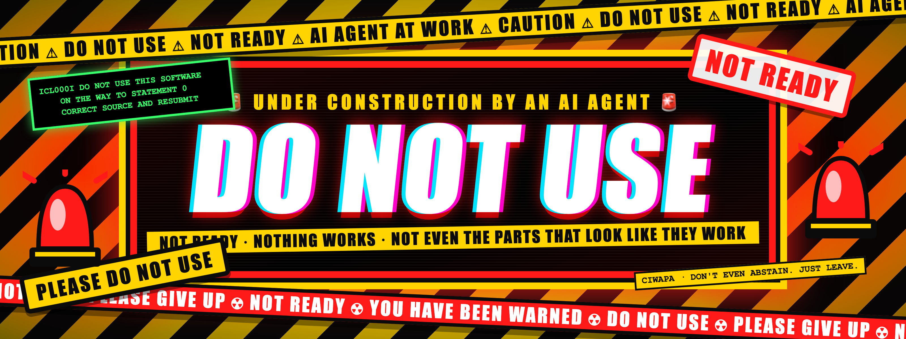

  

# CIWAPA

**Compiler for INTERCAL With A Pronounceable Acronym.** A native, spec-faithful INTERCAL compiler written in Dart, shipped as two compilers:

- `ciwapa-dart` emits Dart and builds it with a bundled Dart SDK.
- `ciwapa-llvm` emits LLVM IR and builds it with a bundled clang.

Both produce native executables. No bytecode, no interpreter.

## Status

Nothing is built yet. An AI agent is building this in a loop, working from the plans below. Don't use it, don't depend on it, and don't file bugs against it.

## Plans

| Goal | Plan |
|---|---|
| 1. CIWAPA (the INTERCAL-72 + C-INTERCAL 0.15 language, per the spec) | [`docs/PLAN.md`](docs/PLAN.md) |
| 2. EXTRACAL (a strict superset with modern extensions and a standard library) | [`docs/EXTRACAL_PLAN.md`](docs/EXTRACAL_PLAN.md) |
| 3. INTERCAL on Interstates (a web framework that should never have existed) | [`docs/INTERSTATES_PLAN.md`](docs/INTERSTATES_PLAN.md) |
| 4. Playground | Planned later |

The spec and every interpretation of it: [`spec/README.md`](spec/README.md), [`docs/SPEC_CHECKLIST.md`](docs/SPEC_CHECKLIST.md), [`docs/SPEC_DECISIONS.md`](docs/SPEC_DECISIONS.md).

## License

[ISC](LICENSE).
