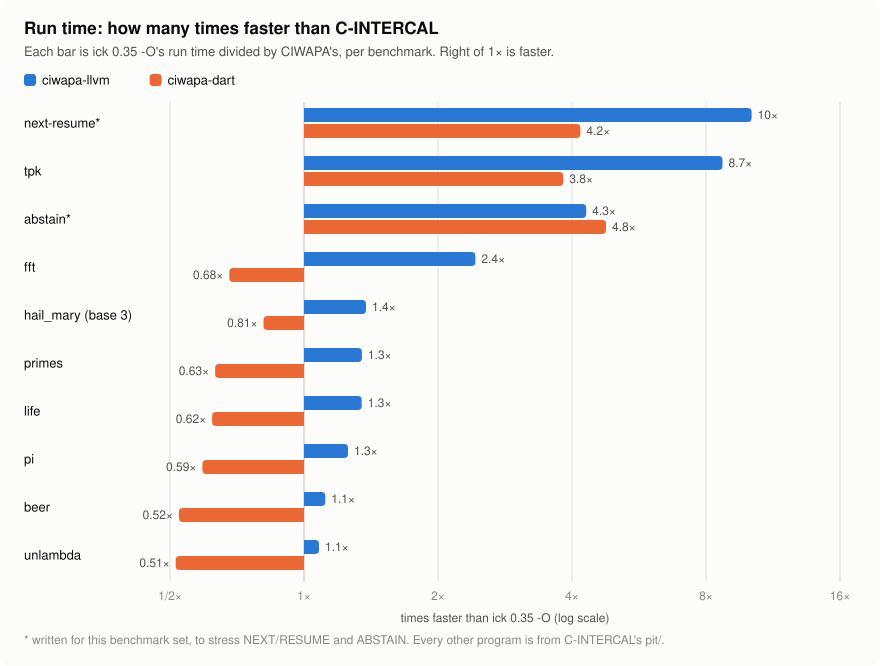
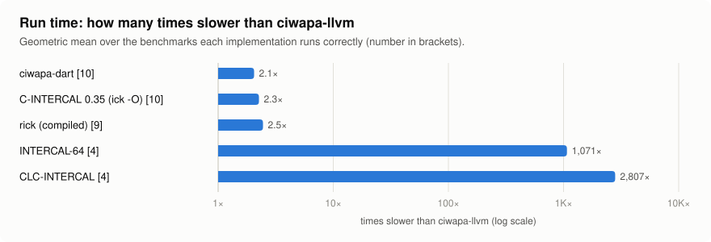
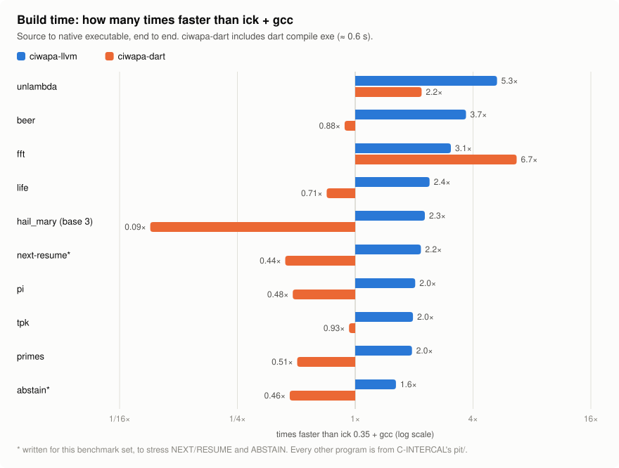

# CIWAPA

**Compiler for INTERCAL With A Pronounceable Acronym.** CIWAPA compiles INTERCAL to native executables. It comes as two compilers that take the same programs and produce the same output:

- `ciwapa-llvm` emits LLVM IR and links it with clang.
- `ciwapa-dart` emits Dart and builds it with `dart compile exe`.

Each download bundles the toolchain its compiler needs. There's no bytecode and no interpreter at run time.

## INTERCAL, briefly

INTERCAL was designed in 1972 to have nothing in common with any other programming language. It has no arithmetic operators. Instead there's *mingle* (`$`, which interleaves the bits of two numbers) and *select* (`~`, which extracts bits through a mask), and adding two numbers means calling a library routine built out of them. Input is spelled out digit by digit in English, output is in Roman numerals, and a program has to say `PLEASE` often enough to be polite, but not so often that it's grovelling.

```
PLEASE DO ,1 <- #2
DO WRITE IN ,1 SUB #2
DO READ OUT ,1 SUB #2
DO GIVE UP
```

```console
$ ciwapa-llvm build nine.i
$ echo NINE | ./nine

IX
```

The blank line is part of the output. Numerals print as two lines, and the first one holds the overlines that multiply a digit by 1,000. This number doesn't need any.

## Install

Download the archive for your platform from [Releases](https://github.com/latticeandcompany/CIWAPA/releases): `ciwapa-<flavor>-<version>-<platform>.tar.xz`, or `.zip` on Windows. Builds exist for `linux-x64`, `linux-arm64`, `macos-arm64`, `windows-x64` and `windows-arm64`.

Unpack it and put its `bin/` on your `PATH`. Keep the folder together, because the compiler finds its toolchain next to `bin/`. Then check the setup:

```sh
ciwapa-llvm doctor
```

- **macOS:** `ciwapa-llvm` uses Apple's clang instead of bundling one. Run `xcode-select --install` once if `doctor` says it's missing.
- **The binaries aren't signed.** On macOS, clear the download quarantine with `xattr -dr com.apple.quarantine ciwapa-*`. On Windows, choose "More info", then "Run anyway" when SmartScreen asks.

Usage:

```sh
ciwapa-llvm build prog.i -o prog     # compile to a native executable
ciwapa-llvm run prog.i               # compile and run in one step
ciwapa-llvm --help                   # every flag
```

`ciwapa-dart` takes the same commands. Compiled programs accept the runtime options from the manual, such as `+wimpmode`, which reads and writes plain decimal numbers in exchange for a humiliating message.

## Three languages

The file extension chooses what a program is written in.

**INTERCAL** (`.i`, and `.3i` to `.7i` for bases 3 to 7) follows [*The INTERCAL Programming Language Revised Reference Manual*](spec/README.md), the edition that shipped with C-INTERCAL 0.15. That includes COME FROM, character I/O, TriINTERCAL's non-binary bases, the system library, and the C-INTERCAL compiler options under their own names (`--traditional`, `--no-random-bug`, `--clockface`). The random compiler bug is on by default, as the manual specifies: each statement has a 1 in 128 chance of an E774 planted at build time.

**EXTRACAL** (`.xc`) is a strict superset. It adds the control statements modern C-INTERCAL grew (NEXT FROM, computed COME FROM, threads, backtracking, CREATE and others), 64-bit and signed numbers, and a standard library for files, strings, sockets and the command line. See [`docs/EXTRACAL.md`](docs/EXTRACAL.md).

**INTERCAL on Interstates** is a web framework for EXTRACAL, built from the [2013 April Fools' site](https://www.intercaloninterstates.org/) of the same name. Routes are `COME FROM`s with a path, templates use `{{ }}`, numbers render as Roman numerals with real overlines, and the database layer, ActiveCassette, numbers its tables instead of naming them. It ships as separate `ioi-<flavor>-<platform>` archives with the `gross` server. See [`docs/INTERSTATES.md`](docs/INTERSTATES.md).

## Performance

These numbers compare CIWAPA with C-INTERCAL 0.35 (`ick -O` with gcc `-O2`), rick in compiled mode, INTERCAL-64 2.0.3 and CLC-INTERCAL 1.00, on eight programs from C-INTERCAL's `pit/` directory and two of our own.

<picture>
  <source media="(prefers-color-scheme: dark)" srcset="docs/assets/perf-speedup-dark.svg">
  
</picture>

`ciwapa-llvm` is faster than every other implementation on every benchmark, and 2.2× faster than the fastest of them on the geometric mean. `ciwapa-dart` is 1.1× faster than `ick` on the geometric mean, but only because of its large wins on `tpk`, `next-resume` and `abstain`. It's slower on the other seven. Part of that is fixed cost: a Dart executable takes longer to start, which dominates programs that run for a millisecond. With each implementation's startup time subtracted, `ciwapa-dart` is 1.34× faster than `ick`.

<picture>
  <source media="(prefers-color-scheme: dark)" srcset="docs/assets/perf-field-dark.svg">
  
</picture>

INTERCAL-64 and CLC-INTERCAL each ran only four of the ten benchmarks correctly, so they're compared on those four. A run only counted if its output matched `ick`'s. INTERCAL-64 can only do number I/O in wimp mode. On the others, CLC-INTERCAL stops with an error, doesn't finish within 15 minutes, or prints slightly different output.

<picture>
  <source media="(prefers-color-scheme: dark)" srcset="docs/assets/perf-build-dark.svg">
  
</picture>

Build time is measured from source to native executable. `ciwapa-dart` can't build faster than `dart compile exe` does, which takes about 0.6 s even for an empty program. CIWAPA's own front end and code generator take at most 14 ms on any benchmark.

<details>
<summary>How these were measured, and the raw numbers</summary>

The numbers are from 2026-10-16, measured on one Linux arm64 machine with every implementation in its own Docker container. Each run time is the fastest of repeated runs: at least one second's worth, up to 200 runs. Each build time is the fastest of three builds.

`primes`, `pi`, `fft` and `life` call routines that only exist inside C-INTERCAL's own system library, so for those four every implementation, CIWAPA included, ran with C-INTERCAL's `syslib.i` appended (and `floatlib.i` for `fft`). CIWAPA's built-in library doesn't take part in those runs. `next-resume` and `abstain` were written for this benchmark set, to stress NEXT/RESUME and ABSTAIN.

Run time, in milliseconds (— means the implementation didn't run that program correctly, or doesn't support base 3):

| Program | ciwapa-llvm | ciwapa-dart | ick 0.35 -O | rick | INTERCAL-64 | CLC-INTERCAL |
|---|---:|---:|---:|---:|---:|---:|
| `tpk` | 1.59 | 3.63 | 13.9 | 13.1 | — | — |
| `unlambda` | 1.20 | 2.52 | 1.30 | 1.58 | 1,571 | 441 |
| `beer` | 1.25 | 2.67 | 1.40 | 1.53 | 731 | 358 |
| `hail_mary` | 1,037 | 1,761 | 1,429 | — | — | — |
| `next-resume` | 7.72 | 18.7 | 78.1 | 63.8 | 21,737 | 342,963 |
| `abstain` | 10.0 | 9.06 | 43.2 | 39.1 | 6,142 | 133,974 |
| `primes` | 1,452 | 3,102 | 1,959 | 2,342 | — | — |
| `pi` | 1.45 | 3.09 | 1.83 | 2.09 | — | — |
| `fft` | 25.9 | 92.6 | 62.9 | 60.6 | — | — |
| `life` | 1.25 | 2.71 | 1.68 | 1.72 | — | — |

Build time, in milliseconds:

| Program | ciwapa-llvm | ciwapa-dart | ick 0.35 + gcc |
|---|---:|---:|---:|
| `tpk` | 398 | 844 | 785 |
| `unlambda` | 350 | 850 | 1,857 |
| `beer` | 177 | 739 | 652 |
| `hail_mary` | 26 | 658 | 59 |
| `next-resume` | 138 | 681 | 299 |
| `abstain` | 197 | 687 | 318 |
| `primes` | 181 | 699 | 353 |
| `pi` | 198 | 836 | 401 |
| `fft` | 2,022 | 933 | 6,232 |
| `life` | 233 | 782 | 559 |

</details>

## Faithful to the manual

The manual has gaps, typos and jokes that read like rules, and a compiler has to settle every one of them. CIWAPA settles them in writing:

- [`docs/SPEC_CHECKLIST.md`](docs/SPEC_CHECKLIST.md) lists 316 rules from the manual, each with its section number and the tests that prove it. Every rule passes in both compilers.
- [`docs/SPEC_DECISIONS.md`](docs/SPEC_DECISIONS.md) records every interpretation and why it was chosen. Where the manual is silent, CIWAPA follows what C-INTERCAL 0.15, the compiler the manual shipped with, actually did.
- Places where CIWAPA deliberately differs from C-INTERCAL are listed under Divergences in the checklist.

Two flavors and one behavior: the conformance suite runs every test program through both compilers and requires identical output, error text and exit codes.

The system library is a clean-room implementation, written from the manual's description of each routine without looking at any existing library's source. When the compiler can prove a program can't tell the difference, it swaps the INTERCAL routines for native ones.

## Documentation

| | |
|---|---|
| [`docs/EXTRACAL.md`](docs/EXTRACAL.md) | Writing EXTRACAL |
| [`docs/INTERSTATES.md`](docs/INTERSTATES.md) | Building sites with INTERCAL on Interstates |
| [`spec/README.md`](spec/README.md) | Where to get the reference manual |
| [`docs/SPEC_CHECKLIST.md`](docs/SPEC_CHECKLIST.md), [`EXTRACAL_CHECKLIST.md`](docs/EXTRACAL_CHECKLIST.md), [`INTERSTATES_CHECKLIST.md`](docs/INTERSTATES_CHECKLIST.md) | Every rule, with its tests |
| [`docs/SPEC_DECISIONS.md`](docs/SPEC_DECISIONS.md) | Every interpretation |
| [`docs/PLAN.md`](docs/PLAN.md), [`EXTRACAL_PLAN.md`](docs/EXTRACAL_PLAN.md), [`INTERSTATES_PLAN.md`](docs/INTERSTATES_PLAN.md) | The design plans |

## License

[ISC](LICENSE).
